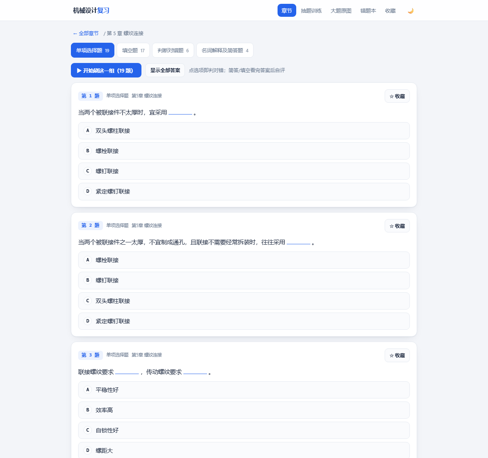

# 机械设计 · 期末复习

一个离线网页小工具：**分章节刷小题 + 随机抽题训练 + 错题本 + 期末大题原图**。

## 怎么打开

双击 `index.html`（Chrome / Edge 都可以）。不需要联网，不需要装东西。

做题进度（做过哪些题、对错、收藏）存在浏览器本地。换浏览器或清了缓存会丢。

> 如果发现进度不保存（个别浏览器对 `file://` 的本地存储有限制），改用本地服务方式打开：
> ```bash
> cd 机械设计复习
> python -m http.server 8080
> ```
> 然后浏览器打开 http://127.0.0.1:8080

## 有什么功能

**📘 分章节刷题**
9 个章节 × 4 种题型，共 295 道小题，答案与题目一一对应。

| 题型 | 题量 | 怎么判分 |
|---|---|---|
| 单项选择题 | 122 | 点选项立刻判对错 |
| 填空题 | 84 | 点「显示答案」后自己评 |
| 判断对错题 | 55 | 点 √ / × 立刻判对错 |
| 名词解释及简答题 | 34 | 点「显示答案」后自己评 |

- 多选题（答案有多个空）会自动变成「依次选够 N 个再提交」
- 每题右上角可以 ☆ 收藏；做错的自动进错题本

**🎯 抽题训练**
自己选章节范围、题型、题量（10/20/30/50/全部），随机抽一套做一遍，做完出成绩并列出本轮错题。

**🔥 大题原图**
按老师给的期末范围截的原书页面，公式和受力图都是原图（不是文字提取），点图可放大：

- 第 3 章：例 1、例 4
- 第 5 章：例 4、5、6、7
- 第 10 章：例 1、例 4、5、8（例 2 老师标注「了解即可」）
- 第 11 章：例 1、例 2（判断旋向）
- 第 13 章：例 1、例 3

**❌ 错题本 / ⭐ 收藏**　错题可以一键重做。

**🌙 夜间模式**　右上角切换。

## 效果

| 首页 | 章节练习 | 大题原图 |
|---|---|---|
|  |  |  |

## 目录结构

```
机械设计复习/
├─ index.html           ← 双击这个
├─ assets/
│  ├─ app.css
│  └─ app.js
├─ data/
│  ├─ questions.js      ← 295 道小题（网页直接读这个）
│  ├─ examples.js       ← 例题索引
│  ├─ questions.json    ← 同上，JSON 原始数据
│  ├─ examples.json
│  ├─ example_index.json
│  └─ hw_raw.txt        ← 习题 PDF 抽出的原始文字（备查）
├─ img/ex/              ← 66 页例题原图（WebP，共 6.5 MB）
├─ screenshots/
└─ tools/               ← 数据是怎么从 PDF 变出来的（可重跑）
```

## 数据来源

- 小题：《机械设计习题.pdf》
- 大题：《机械设计例题汇总.pdf》

两份都在微信文件目录：
`E:\xwechat_files\wxid_iydyyuetduoq22_8f6a\msg\file\2026-11\`

## 重新生成数据（一般用不到）

需要用到 DSH 自带的那套 Python（有 PyMuPDF、Pillow）：

```bash
cd 机械设计复习
PY="C:/Users/31065/.dsh/dsh-runtimes/dsh-primary-runtime/dependencies/python/python.exe"
export PYTHONIOENCODING=utf-8

"$PY" tools/probe.py            # 看 PDF 结构
"$PY" tools/extract_hw.py       # 习题 -> data/questions.json
"$PY" tools/index_examples.py   # 例题页码索引
"$PY" tools/render_examples.py  # 例题渲染成 WebP（SKIP_RENDER=1 可只重建索引）
"$PY" tools/pack_data.py        # JSON -> 网页用的 .js
```
