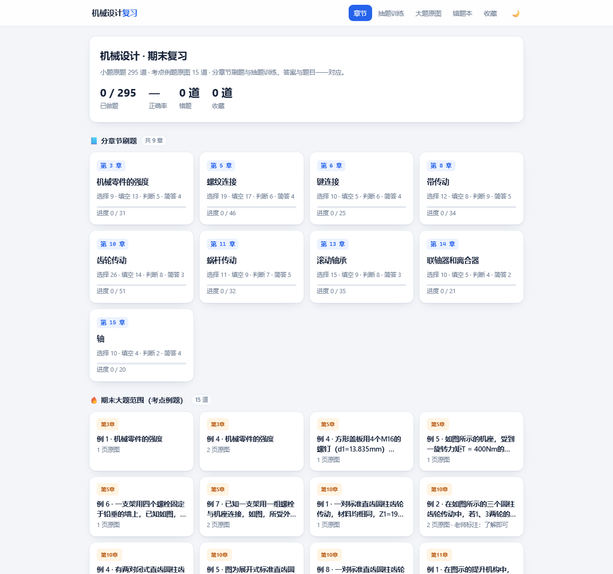
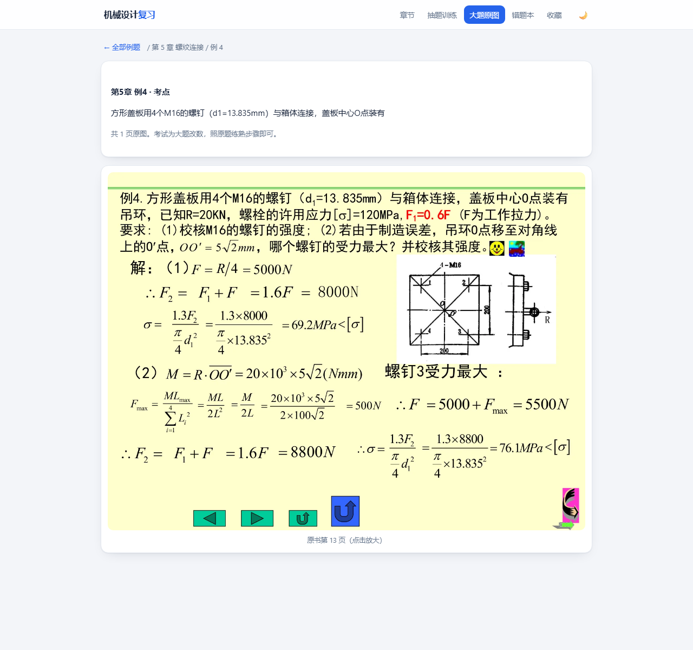

# 机械设计 · 期末复习

一个网页小工具：**分章节刷小题 + 随机抽题训练 + 错题本 + 期末大题原图**。

## 在哪打开

| 方式 | 地址 | 说明 |
|---|---|---|
| 手机 / 平板 | http://172.30.212.117:8000/ | 连同一个 WiFi，要先起本地服务 |
| 电脑本机 | http://127.0.0.1:8000/ | 同上 |
| 线上 | https://apeanuta.github.io/mech-design-review/ | 随时能开，也可以发链接给同学 |
| 离线 | 双击 `index.html` | 不用联网、不用起服务 |

> 本地那个 IP 是**当前** WLAN 的地址，换网络会变。查法：`ipconfig` 里「WLAN」那条的 IPv4。

做题进度（做过哪些题、对错、收藏）存在**浏览器本地**，每台设备各存各的、不互通；
换浏览器或清了缓存会丢。

## 起本地服务

```bash
cd 机械设计复习
"C:/Users/31065/.dsh/dsh-runtimes/dsh-primary-runtime/dependencies/python/python.exe" -m http.server 8000 --bind 0.0.0.0
```

> 别用 8080：那个端口被 DSH 自己的 CEF 调试服务占着（绑在 127.0.0.1），
> 两个进程抢一个端口会让 `127.0.0.1:8080` 打开的是调试页而不是这个工具。

## 有什么功能

**📘 分章节刷题**
9 个章节 × 4 种题型，共 295 道小题，答案与题目一一对应。

| 题型 | 题量 | 怎么判分 |
|---|---|---|
| 单项选择题 | 122 | 点选项立刻判对错 |
| 填空题 | 84 | 点「显示答案」后自己评 |
| 判断对错题 | 55 | 点 √ / × 立刻判对错 |
| 名词解释及简答题 | 34 | 点「显示答案」后自己评 |

- 多选题（答案有多个空）会自动变成「依次选够 N 个再提交」
- 每题右上角可以 ☆ 收藏；做错的自动进错题本

**关于公式和角标**
题目里的数学式子用 **KaTeX** 排成印刷体：根号带横线、分数是真分数、希腊字母用数学斜体，
和书上一个样。渲染引擎打包在 `assets/katex/`（592 KB，只留 woff2 字体），
**完全离线，不联网、不依赖 CDN** —— 双击 index.html 打开也能正常显示。
数据里用 `$...$` 包 LaTeX 源码表示公式；人工对照原卷核对过的公式都这样写，
位置在 `tools/extract_hw.py` 的 `FIX_STEM` / `FIX_OPTION` / `FIX_ANSWER` 三张表里，**重跑解析不会丢**。
没写 `$` 的普通角标（`σ_b`、`d_1`、`z_2` 这类）仍由 `assets/app.js` 的 `mathPlain()` 用规则转成上下标，
材料牌号（HT200、ZCuSn10P1）和螺纹规格（M12~M16）不会被误伤。

**✍️ 填空/简答题的「原书答案」原图**
填空题和简答题的答案里有公式，而公式在 PDF 文字层里是碎的——
第 5 章填空 1 的 $\tan\lambda/\tan(\lambda+\varphi_v)$ 提出来会变成 `)tan(tanvφλλ+`。
所以这两类题（共 118 道）除文字外，还配了一张**从原卷裁下来的答案图**，
公式以原图为准；碎掉的文字版收在下面一个折叠里，要复制时再展开。

**🎯 抽题训练**
自己选章节范围、题型、题量（10/20/30/50/全部），随机抽一套做一遍，做完出成绩并列出本轮错题。

**🔥 大题原图**
按老师给的期末范围截的原书页面，公式和受力图都是原图（不是文字提取），点图可放大：

- 第 3 章：例 1、例 4
- 第 5 章：例 4、5、6、7
- 第 10 章：例 1、例 4、5、8（例 2 老师标注「了解即可」）
- 第 11 章：例 1、例 2（判断旋向）
- 第 13 章：例 1、例 3

**❌ 错题本 / ⭐ 收藏**　错题可以一键重做。

**🌙 夜间模式**　右上角切换。

## 效果

| 首页 | 章节练习 | 大题原图 |
|---|---|---|
|  |  |  |

## 目录结构

```
机械设计复习/
├─ index.html           ← 双击这个
├─ assets/
│  ├─ app.css
│  └─ app.js
├─ data/
│  ├─ questions.js      ← 295 道小题 + 答案图索引（网页直接读这个）
│  ├─ examples.js       ← 例题索引
│  ├─ questions.json    ← 同上，JSON 原始数据
│  ├─ examples.json
│  ├─ example_index.json
│  ├─ answer_imgs.json  ← 答案小图的尺寸索引
│  └─ hw_raw.txt        ← 习题 PDF 抽出的原始文字（备查）
├─ img/ex/              ← 66 页例题原图（WebP，6.5 MB）
├─ img/ans/             ← 118 张填空/简答答案小图（WebP，1.3 MB）
├─ screenshots/
└─ tools/               ← 数据是怎么从 PDF 变出来的（可重跑）
```

## 数据来源

- 小题：《机械设计习题.pdf》
- 大题：《机械设计例题汇总.pdf》

两份都在微信文件目录：
`E:\xwechat_files\wxid_iydyyuetduoq22_8f6a\msg\file\2026-11\`

## 重新生成数据（一般用不到）

需要用到 DSH 自带的那套 Python（有 PyMuPDF、Pillow）：

```bash
cd 机械设计复习
PY="C:/Users/31065/.dsh/dsh-runtimes/dsh-primary-runtime/dependencies/python/python.exe"
export PYTHONIOENCODING=utf-8

"$PY" tools/probe.py            # 看 PDF 结构
"$PY" tools/extract_hw.py       # 习题 -> data/questions.json
"$PY" tools/verify_answers.py   # 查答案字段有没有异常
"$PY" tools/verify_map.py       # 独立重扫答案区，核对每题号都对得上
"$PY" tools/check_judge.py      # 判断题 √/× 逐字对照 PDF 原文
"$PY" tools/index_examples.py   # 例题页码索引
"$PY" tools/render_examples.py  # 例题渲染成 WebP（SKIP_RENDER=1 可只重建索引）
"$PY" tools/render_answers.py   # 填空/简答答案裁剪成小图
"$PY" tools/pack_data.py        # JSON -> 网页用的 .js
```
